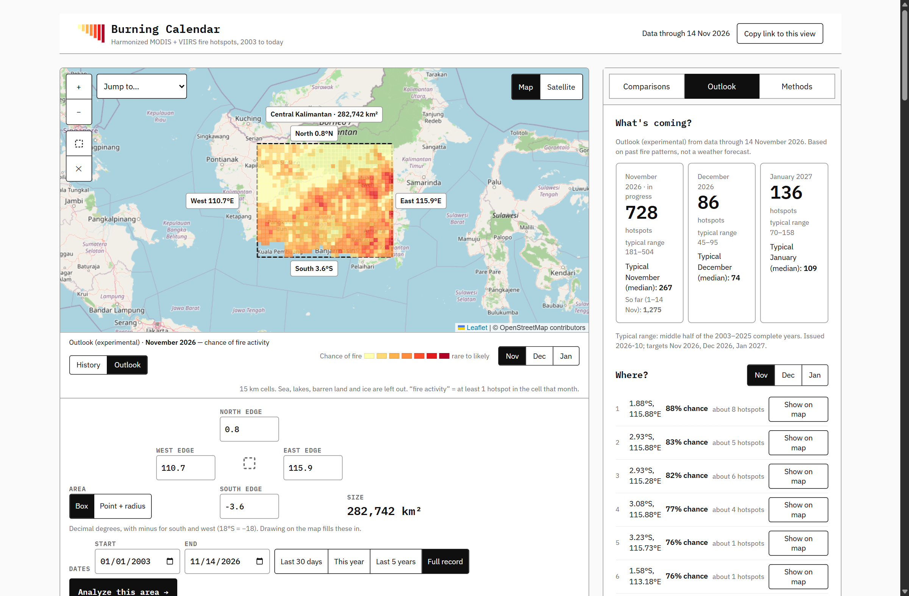

# Burning Calendar — burning activity, harmonized, 2003 to today

A web app that turns decades of MODIS and VIIRS fire-detection rows into one
clean burning-activity calendar for **Southeast Asia**: when the season comes,
how big it gets, and where it usually burns. It serves everything from a
server-side DuckDB over partitioned Parquet — the browser never sees raw
detections.



## What it does

- **A calendar of fire, 2003-01-01 to 2026-11-14.** One page per area (any box
  or point+radius up to 500,000 km²): hotspots per month by year, per-year
  totals, seasonal median/p25/p75, anomalies vs the baseline years, and which
  years burned most.
- **One measurement across sensors.** MODIS (Aqua, 2003 to Feb 2012) and VIIRS
  (S-NPP, then NOAA-20/21) count fires differently. Every MODIS cell-day is
  scaled by a shrunk tile/month factor `k`, so the whole record is expressed in
  VIIRS-equivalent cell-days. Days without VIIRS coverage are filled from
  Terra, scaled the same way.
- **An Outlook (experimental) for the next three months.** A 15 km grid with a
  per-cell, per-month estimate learned only from *where and when* fires
  happened before. It is not a weather model and not a fire danger forecast.
- **Downloadable data.** Monthly fires per 15 km cell as CSV or Parquet, the
  Outlook CSV, hotspots/calendar/CSV or PNG exports.

## Coverage and results

- Region: Southeast Asia (92–141°E, 11°S–28.5°N). Southeast Asia only tonight;
  the Amazon backfill was dropped from this release.
- Record: 2003-01-01 to 2026-11-14 (latest date the harmonized series
  completes; both the night and the day pass recorded).
- 2026, region-wide: 585,315 hotspots through Nov 14, with the dry season peaking in September (Aug 52,926 · Sep 66,520 · Oct 63,046). In Central Kalimantan: Aug 12,815 · Sep 15,716 · Oct 14,083 · Nov 1–14 1,261 (62% of these in forest).
- The outlook grid: 86,328 cells of 15 km; 26,015 kept (69.9% of cells are
  sea/lake/barren/ice and carry no fire model); the masked cells hold 0.04% of
  all recorded fire. Masked cells are never drawn and never predicted.
- Backtest (climatology only, tested on 2015–2025): the top 10% of predicted
  cells held **62.35%** of a month's fire (Brier score 0.1132); the big years
  landed the same (2015: 63.0% · 2019: 63.9% · 2023: 63.4%).
- Calibration: VIIRS-referenced `k` with shrinkage (SHRINK_M=30); held-out
  years 2018–2021 in the Methods tab (e.g. r ≈ 0.95+, bias −2..5%).

## Run it

You need: the processed snapshot, `FIRMS_MAP_KEY` (optional, only for live
updates), and Docker.

```bash
# 1. Unpack/copy the submission snapshot so ./data holds the processed store.
#    (snapshots/v2-southeast-asia-outlook -> ./data: the app reads ./data/processed/...)
# 2. (optional, for the live updater) put a 32-char FIRMS key in .env — sign up
#    at https://firms.modaps.eosdis.nasa.gov/api/map_key
echo "FIRMS_MAP_KEY=<your key>" > .env
# 3.
docker compose up --build
```

Open http://localhost:8080. The `web` container serves the app and the API
read-only; the `updater` container refreshes the data daily when a key is set.
Without a key, the app works fully against the snapshot — pick the starter
area *Central Kalimantan*, the default view.

Useful surfaces:

- **Outlook tab** (side panel): "What's coming?" for the next three months,
  the ten most likely cells, when the area usually burns, and how reliable the
  backtest numbers were.
- **Map → History | Outlook**: chance-of-fire colors (fixed bins; a chance of
  exactly 5% falls in the second bin).
- **Methods tab**: how everything here is computed, including the water/ice
  mask and the outlook's rules and limits.
- **Downloads**: monthly 15 km cells CSV/Parquet; Outlook CSV; hotspots CSV.
- API: `GET /api/outlook`, `/api/outlook/map`, `/api/outlook.csv`,
  `/api/cells.csv`, `/api/cells.parquet`, plus the usual calendar/summary/map/
  coverage endpoints.

## What the outlook is — and is not

- It is **the historical pattern of where and when fire happens**, per cell and
  month: a chance of fire activity (at least 1 hotspot in the cell that month)
  and an expected count, learned from 2003–present, with chances fitted on
  VIIRS-era years only (2013+) so the sensor change doesn't leak in as a trend.
- It **is not a weather-based fire danger forecast**, and it is not a
  probability that "fire will happen at your house tomorrow". A cell with no
  recorded history reads as unlikely; a new fire regime can surprise it.
- It is issued monthly on the back of the latest complete month; targets are
  the next three months. Latest issue: **2026-10** (targets Nov 2026,
  Dec 2026, Jan 2027).

## Known limits

- **Climatology only.** No weather, no fuel-moisture, no wind, no ENSO. It
  cannot say *this* drought year will be extreme; it can say the historical
  season is September.
- **Grid honesty.** The 0.15° cells are 3×3 of the 0.05° grid; edge cells at
  the box's south/west lines hold 2–6 of the 9 fine cells and their area and
  counts reflect the part inside (on-edge fine cells are ~1 in 10,000 of the
  fine grid).
- **MODIS was estimated.** Before Feb 2012 every hotspot is a MODIS×k estimate
  (±13% typical error globally; ±5.5% on this region's held-out years).
- **NRT caveat.** NASA NRT files carry no `type` column, so static sources
  (gas flares, volcanoes) can't be filtered out of recent weeks. Measured:
  242,342 (12.1%) of 2026-NRT detections sit in cells with archive type 1/2
  detections — expect some small flares near those cells until the next
  standard-processing re-ingest.
- **Mask is from land, never from fire.** Sea/lake/barren/ice cells hold no
  outlook (0.04% of fire was dropped with them). Wetlands (peat swamps) are
  kept — that is where Kalimantan burns.
- Single writer at a time; data is Southeast Asia only.
