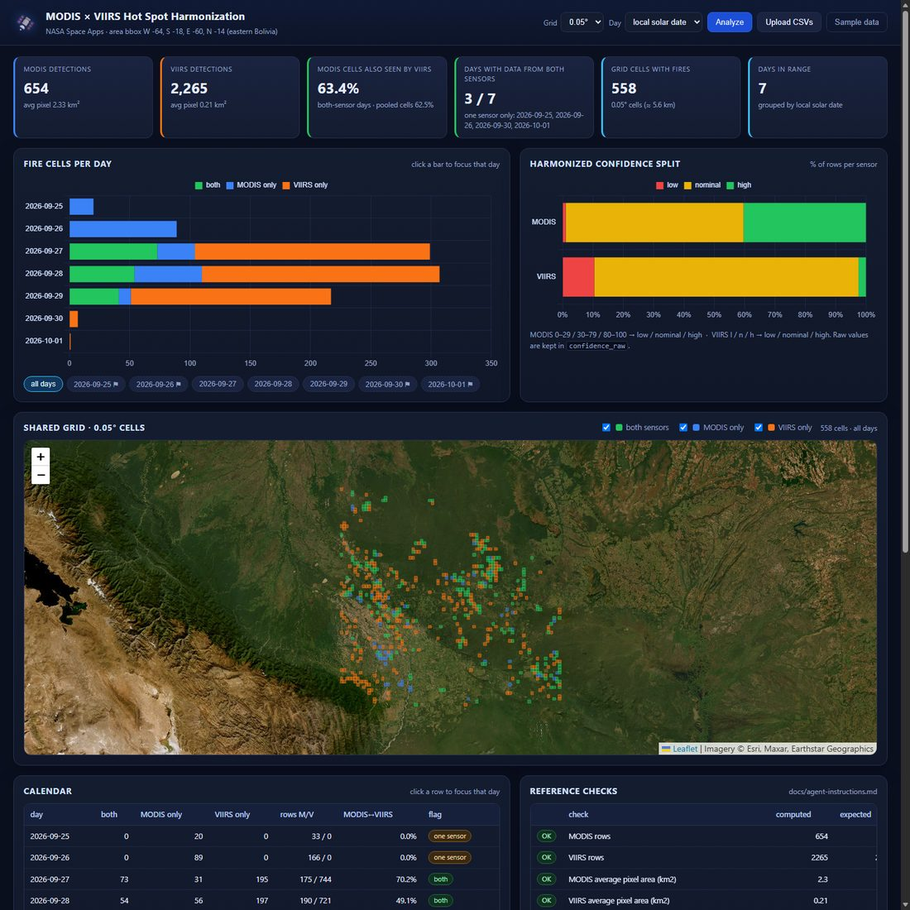

# MODIS × VIIRS Hot Spot Harmonization

An interactive web app for the NASA Space Apps challenge **“Harmonization of MODIS
and VIIRS Hot Spots”**. It compares two satellite fire datasets that describe the
same fires differently, puts them on a common footing, and shows where they agree —
in your browser, from your own machine.



## What this is

NASA FIRMS publishes active-fire detections from two instruments:

* **MODIS** (Terra/Aqua) — coarser pixels (~2 km²), confidence as a number 0–100
* **VIIRS** (SNPP) — finer pixels (~0.2 km²), confidence as a letter `l / n / h`

Because the pixel sizes, confidence scales and overpass times differ, you cannot
simply count detections side by side. This app harmonizes them so they become
comparable, then measures how much the two sensors overlap.

It works on the two CSVs downloaded from the NASA FIRMS area API for the box
**W -64, S -18, E -60, N -14** (eastern Bolivia), bundled in `sample-data/`:

* `modis.csv` — source `MODIS_NRT`, 654 rows
* `viirs.csv` — source `VIIRS_SNPP_NRT`, 2,265 rows

The analysis (implemented once in `compare.py`, used by both the script and the
web app) does the following:

1. loads both files and tags every row with a `sensor` column
2. builds a UTC datetime from `acq_date` + `acq_time` (HHMM, e.g. `18` = 00:18)
3. converts to **local solar time** — `local = utc + (longitude / 15)` hours — and
   uses the local date as the row’s “day”
4. **harmonizes confidence**: MODIS `0-29 / 30-79 / 80-100` → `low / nominal / high`,
   VIIRS `l / n / h` → `low / nominal / high` (the original value is kept in
   `confidence_raw`)
5. puts both sensors on **one shared grid**: `cell = (⌊lat / GRID⌋, ⌊lon / GRID⌋)`,
   `GRID = 0.05°` by default
6. for every local day, counts cells seen by **both** sensors, **MODIS only** and
   **VIIRS only**, plus raw row counts — flagging days where only one sensor flew
7. prints a summary: rows per sensor, average pixel area, confidence split, and the
   share of MODIS cells also seen by VIIRS
8. writes `outputs/combined.csv` and `outputs/calendar.csv`
9. draws `outputs/calendar.png` — one horizontal stacked bar per day
   (both = green, MODIS only = blue, VIIRS only = orange)

**What you get:** a dashboard with KPI cards, per-day charts, a map of every grid
cell, a calendar with overlap percentages, a table of all 2,919 detections,
validation against the reference numbers, and downloadable CSV/PNG outputs.

---

## Run it locally

You only need **Docker** *or* **Python 3.10+** — not both.

### Option A — Docker (recommended, nothing to install but Docker)

```bash
docker compose up --build
```

Open **<http://127.0.0.1:8000>**.

```bash
docker compose up -d --build     # run in the background
docker compose ps                # should show "Up (healthy)"
docker compose logs -f           # follow the logs
docker compose down              # stop and remove the container
```

If you don’t have the Compose plugin, plain Docker works too:

```bash
docker build -t modis-viirs .
docker run --rm -p 8000:8000 modis-viirs
```

`outputs/` and `uploads/` are mounted from your working copy, so anything the app
generates or you upload stays on your machine.

### Option B — plain Python (no Docker)

```bash
cd 4-bcc-nasa                       # the folder you cloned or downloaded

python -m venv .venv
# Windows PowerShell:  .venv\Scripts\Activate.ps1
# Windows cmd:         .venv\Scripts\activate
# macOS / Linux:       source .venv/bin/activate

pip install -r requirements.txt
python app.py                   # → http://127.0.0.1:8000
```

Stop it with `Ctrl+C`. Re-run any time; nothing is installed outside the venv.

### Option C — script only, no web app

```bash
pip install pandas numpy matplotlib
python compare.py
```

It prints the summary and the reference checks, then writes
`outputs/combined.csv`, `outputs/calendar.csv` and `outputs/calendar.png`.

### Prerequisites & troubleshooting

| Issue | Fix |
|---|---|
| Port 8000 already in use | Stop the other process, or edit the port in `docker-compose.yml` / `app.py` |
| `docker: error while creating mount source path` | Create empty `outputs/` and `uploads/` folders first (Windows), or remove those two lines from `docker-compose.yml` |
| pandas crashes with an access violation | `requirements.txt` pins `pandas==2.3.3`; pandas 3.0.x misbehaved on one dev machine, so keep `pandas<3` |
| Chart/map looks empty | Re-run with **Analyze**; the map needs an internet connection for satellite tiles (the cells still draw without it) |
| Want your own data | Click **Upload CSVs** in the app, or drop your files into `sample-data/` and restart |

---

## What the dashboard lets you do

| Section | Interaction |
|---|---|
| **Settings** | grid size (0.01°–0.2°), day basis (local solar vs UTC), re-run |
| **KPI cards** | rows per sensor, average pixel area, MODIS↔VIIRS overlap, coverage days |
| **Fire cells per day** | stacked bar per day (both / MODIS only / VIIRS only) — **click a bar to focus that day** |
| **Confidence split** | harmonized low/nominal/high shares per sensor |
| **Day chips** | include/exclude days everywhere at once (map + tables) |
| **Map** | every grid cell drawn as a rectangle: green = both sensors, blue = MODIS only, orange = VIIRS only; toggle categories; click a cell for counts |
| **Calendar** | one row per day with cell counts, row counts, per-day overlap % and a one-sensor flag — click a row to focus that day |
| **Reference checks** | computed vs expected values from `docs/agent-instructions.md` |
| **Detections** | filter by sensor / confidence / day, free-text search, sortable columns, paging |
| **Upload CSVs** | analyze your own FIRMS pair (same columns); **Sample data** restores the bundled files |
| **Outputs** | download `combined.csv`, `calendar.csv`, `calendar.png` |

---

## Validation against the reference numbers

`compare.py` (and the dashboard’s *Reference checks* panel) compares its output with
the numbers given in `docs/agent-instructions.md`. All of them match:

| Check | Computed | Expected |
|---|---|---|
| MODIS rows | 654 | 654 |
| VIIRS rows | 2,265 | 2,265 |
| MODIS average pixel area | 2.33 km² | ~2.3 km² |
| VIIRS average pixel area | 0.21 km² | ~0.21 km² |
| MODIS confidence split | 1.1 / 58.6 / 40.4 % | ~1 / 59 / 40 % |
| VIIRS confidence split | 10.5 / 87.0 / 2.5 % | ~10 / 87 / 2.5 % |
| 27 Sep cells (both / MODIS only / VIIRS only) | 73 / 31 / 195 | 73 / 31 / 195 |
| 27–28 Sep: MODIS cells also seen by VIIRS | **59.3 %** | ~59 % |

### Why the headline overlap is 63.4 % and not 59 %

The instructions ask for *“the share of MODIS cells also seen by VIIRS, using only
days where both sensors have data”*. With these files **three** local days have data
from both sensors — 27, 28 **and 29 Sep** — so that statistic over all of them is
**63.4 %** (cell-day basis) / **62.5 %** (cells pooled over the days, still requiring
both sensors to have seen the cell on the *same* day).

The “≈ 59 %” reference is the same statistic restricted to the two days it names
(27–28 Sep), which is **59.3 %** — shown as its own check, so both can be compared
side by side. No number was changed to force a match.

---

## Project layout

```
compare.py                the analysis (steps 1-9), run with `python compare.py`
app.py                    Flask API + pages, imports compare.py
templates/index.html      dashboard markup
static/css/app.css        styling
static/js/app.js          charts (Chart.js), map (Leaflet), tables, filters
static/vendor/            Chart.js + Leaflet (bundled, no CDN needed)
sample-data/modis.csv     NASA FIRMS area API download (MODIS_NRT)
sample-data/viirs.csv     NASA FIRMS area API download (VIIRS_SNPP_NRT)
outputs/                  combined.csv, calendar.csv, calendar.png (generated)
uploads/                  CSVs you upload in the browser
docs/agent-instructions.md   the challenge instructions
docs/dashboard.jpg        screenshot of the dashboard
Dockerfile, docker-compose.yml, requirements.txt
```

### API

| Route | Purpose |
|---|---|
| `GET /` | dashboard |
| `GET /health` | liveness probe (`{"status":"ok"}`) |
| `GET /api/state` | which files are loaded + available grid sizes |
| `GET /api/analyze?grid=0.05&day_mode=local` | full analysis report (JSON) |
| `POST /api/upload` (multipart `modis`, `viirs`) | switch to your own CSVs |
| `POST /api/reset` | back to the bundled sample files |
| `GET /api/download/{combined.csv,calendar.csv,calendar.png}` | regenerate + download |
